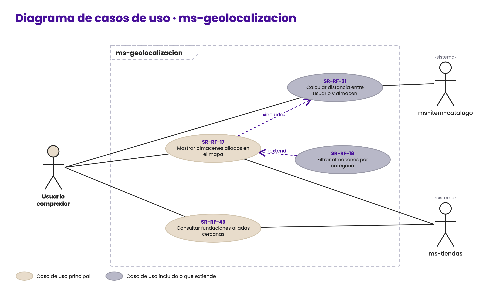
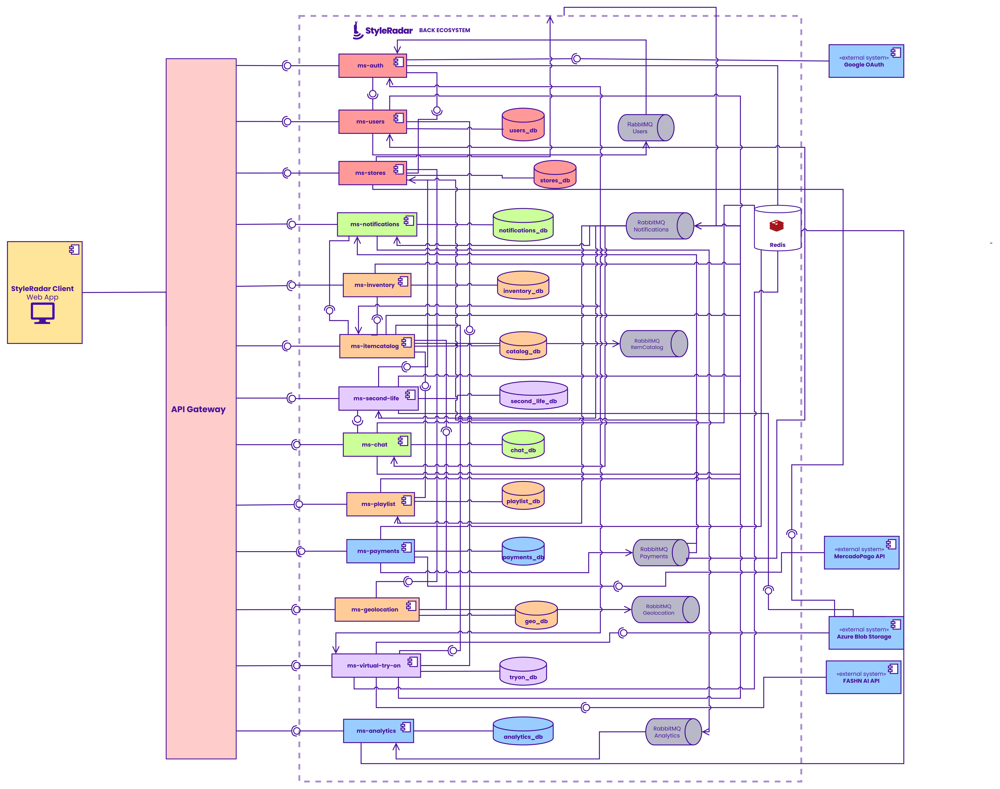
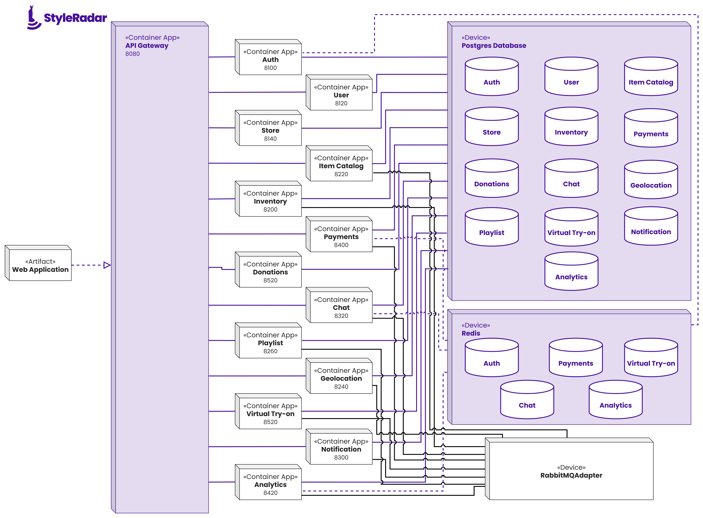
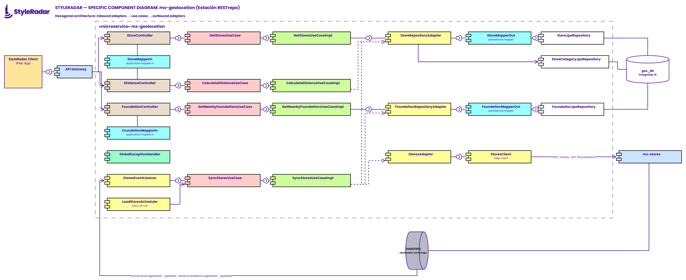
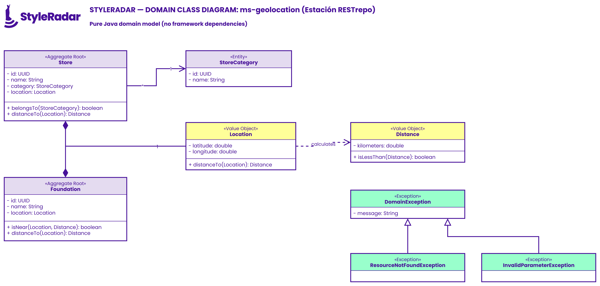
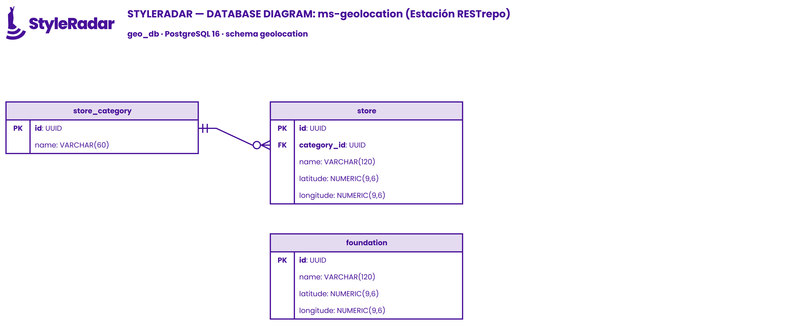
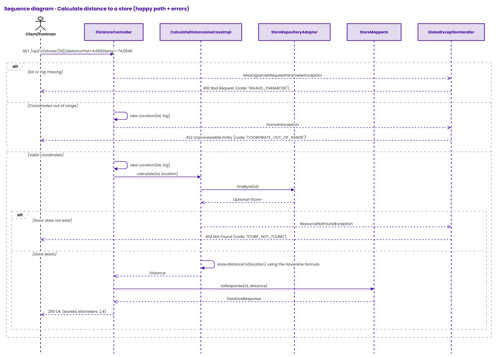
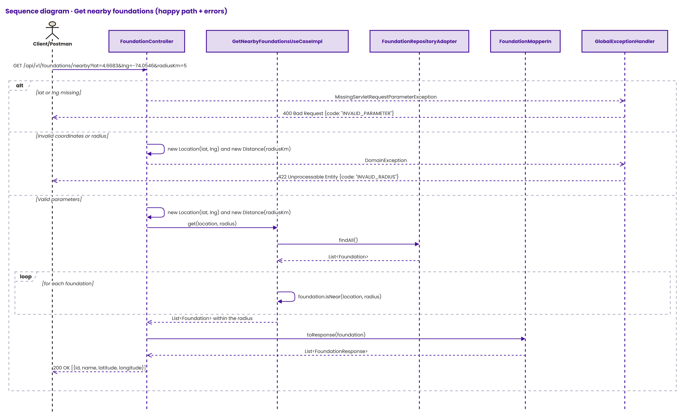

##  3. ARQUITECTURA HEXAGONAL CON SU DIAGRAMA

El servicio sigue la arquitectura hexagonal acordada por el curso. Las reglas del negocio se mantienen aisladas de las herramientas externas, como la base de datos, el broker de mensajería o la API REST, de modo que estas pueden cambiar sin afectar la lógica principal.

### Diagrama de Casos de Uso

<div align="center">
  <table width="100%" style="margin: 18px 0; border: 2px dashed #C4B5FD; border-radius: 8px; background-color: #FBFBFE;">
    <tr>
      <td align="center" style="padding: 20px;">
        <p>
          <br />
          <strong><font color="#5600EF" size="3">DIAGRAMA DE CASOS DE USO · MS-GEOLOCALIZACION</font></strong>
        </p>
        <p>
          <br />
        </p>
      </td>
    </tr>
  </table>
</div>

El usuario comprador ve los almacenes aliados en el mapa según su ubicación (SR-RF-17), lo que incluye calcular la distancia a cada almacén (SR-RF-21); el filtro por categoría (SR-RF-18) extiende el mapa. También consulta la distancia a un almacén puntual y las fundaciones aliadas cercanas (SR-RF-43). `ms-item-catalogo` usa el cálculo de distancia para ordenar las prendas por cercanía. Cada caso de uso lleva el código de su requerimiento en el análisis de requerimientos, los actores usan los nombres oficiales del análisis y el rectángulo marca el límite del microservicio. El archivo editable está en `docs/evidencias/diagrama-casos-uso.drawio`.

### Diagrama de Componentes General

<div align="center">
  <table width="100%" style="margin: 18px 0; border: 2px dashed #C4B5FD; border-radius: 8px; background-color: #FBFBFE;">
    <tr>
      <td align="center" style="padding: 20px;">
        <p>
          <br />
          <strong><font color="#5600EF" size="3">DIAGRAMA DE COMPONENTES GENERAL · STYLERADAR</font></strong>
        </p>
        <p>
          <br />
        </p>
      </td>
    </tr>
  </table>
</div>

Diagrama de componentes general de StyleRadar, el mismo para todos los microservicios. El archivo editable está en `docs/evidencias/DespligueYComponentesGeneral.drawio` (página GeneralComponentDiagram).

### Diagrama de Despliegue

<div align="center">
  <table width="100%" style="margin: 18px 0; border: 2px dashed #C4B5FD; border-radius: 8px; background-color: #FBFBFE;">
    <tr>
      <td align="center" style="padding: 20px;">
        <p>
          <br />
          <strong><font color="#5600EF" size="3">DIAGRAMA DE DESPLIEGUE · STYLERADAR</font></strong>
        </p>
        <p>
          <br />
        </p>
      </td>
    </tr>
  </table>
</div>

Diagrama de despliegue general de StyleRadar, el mismo para todos los microservicios. El archivo editable está en `docs/evidencias/DespligueYComponentesGeneral.drawio` (página DeploymentDiagram).

### Diagrama de Componentes Específico

<div align="center">
  <table width="100%" style="margin: 18px 0; border: 2px dashed #C4B5FD; border-radius: 8px; background-color: #FBFBFE;">
    <tr>
      <td align="center" style="padding: 20px;">
        <p>
          <br />
          <strong><font color="#5600EF" size="3">DIAGRAMA DE COMPONENTES ESPECÍFICO (HEXAGONAL)</font></strong>
        </p>
        <p>
          <br />
        </p>
      </td>
    </tr>
  </table>
</div>

El diagrama muestra el servicio en arquitectura hexagonal. Las peticiones llegan desde el API Gateway a los controllers REST (adaptadores de entrada), que usan un mapper de entrada para convertir la petición al modelo de dominio y solo conocen la interfaz del caso de uso (puerto de entrada). La implementación del caso de uso (`<Nombre>Impl`) aplica las reglas del dominio y usa los puertos de salida para consultar la base de datos a través de los adaptadores de persistencia, que usan un mapper de salida para convertir el dominio a la entidad de base de datos. Se organiza en tres flujos: consulta y filtro de almacenes en el mapa (SR-RF-17 y 18), cálculo de distancia entre el usuario y un almacén (SR-RF-21) y consulta de fundaciones cercanas (SR-RF-43). Además, `CargaTiendasScheduler` ejecuta cada 30 minutos el caso de uso `SincronizarTiendasUseCase`, que usa el puerto `TiendasPort`; su adaptador `TiendasAdapter` consulta por Feign (`TiendasClient`) los almacenes aprobados y las fundaciones activas de `ms-tiendas` y los guarda en la base de datos. Los eventos de `ms-tiendas` llegan por RabbitMQ a `TiendasEventListener`, que usa el mismo caso de uso. Las dependencias apuntan hacia adentro, por lo que el dominio no conoce Spring, JPA ni HTTP.

### Diagrama de Clases

<div align="center">
  <table width="100%" style="margin: 18px 0; border: 2px dashed #C4B5FD; border-radius: 8px; background-color: #FBFBFE;">
    <tr>
      <td align="center" style="padding: 20px;">
        <p>
          <br />
          <strong><font color="#5600EF" size="3">DIAGRAMA DE CLASES DEL DOMINIO</font></strong>
        </p>
        <p>
          <br />
        </p>
      </td>
    </tr>
  </table>
</div>

El dominio tiene dos agregados: `Almacen` y `Fundacion`, ambos con una `Ubicacion` (value object con latitud y longitud). `Ubicacion` calcula la `Distancia` hacia otra ubicación, lo que resuelve el cálculo de distancia (SR-RF-21) y la búsqueda de fundaciones cercanas (SR-RF-43). `CategoriaAlmacen` es una entidad compartida por varios almacenes y permite filtrarlos en el mapa (SR-RF-18). Las excepciones de dominio representan errores de negocio, como un almacén que no existe. Los almacenes y fundaciones se crean o actualizan a partir de los eventos de `ms-tiendas`.

### Diagrama de Base de Datos

<div align="center">
  <table width="100%" style="margin: 18px 0; border: 2px dashed #C4B5FD; border-radius: 8px; background-color: #FBFBFE;">
    <tr>
      <td align="center" style="padding: 20px;">
        <p>
          <br />
          <strong><font color="#5600EF" size="3">MODELO DE DATOS (POSTGRESQL)</font></strong>
        </p>
        <p>
          <br />
        </p>
      </td>
    </tr>
  </table>
</div>

Se usa PostgreSQL porque los almacenes y las fundaciones tienen una estructura fija y las consultas son por filtros y coordenadas. Cada agregado se guarda en su propia tabla y la ubicación se almacena como dos columnas (`latitud` y `longitud`) dentro de la misma fila, ya que es un value object. Las categorías se normalizan en `categoria_almacen`, relacionada uno a muchos con `almacen`, para filtrar por categoría sin repetir texto. La base de datos es exclusiva del servicio (*Database-per-Service*).

### Diagramas de Secuencia

Los diagramas muestran, para cada funcionalidad, el recorrido de la petición por las capas del servicio, tanto en el camino exitoso como en los errores. Los fragmentos `alt` y `loop` separan cada caso. Los archivos editables de draw.io están junto a las imágenes en `docs/evidencias`.

<div align="center">
  <table width="100%" style="margin: 18px 0; border: 2px dashed #C4B5FD; border-radius: 8px; background-color: #FBFBFE;">
    <tr>
      <td align="center" style="padding: 20px;">
        <p>
          <br />
          <strong><font color="#5600EF" size="3">CALCULAR DISTANCIA AL ALMACÉN</font></strong>
        </p>
        <p>
          <br />
        </p>
      </td>
    </tr>
  </table>
</div>

El cliente envía la ubicación del usuario. Si falta la latitud o la longitud se responde 400, y si están fuera de rango el dominio lo rechaza al crear la `Ubicacion` y se responde 422. Con coordenadas válidas, el caso de uso busca el almacén (si no existe, 404) y calcula la distancia con la fórmula de Haversine. Se responde 200 con los kilómetros (SR-RF-21).

<div align="center">
  <table width="100%" style="margin: 18px 0; border: 2px dashed #C4B5FD; border-radius: 8px; background-color: #FBFBFE;">
    <tr>
      <td align="center" style="padding: 20px;">
        <p>
          <br />
          <strong><font color="#5600EF" size="3">CONSULTAR FUNDACIONES CERCANAS</font></strong>
        </p>
        <p>
          <br />
        </p>
      </td>
    </tr>
  </table>
</div>

Con la ubicación del usuario y un radio en kilómetros (5 por defecto), el caso de uso trae las fundaciones y en el `loop` revisa una por una si está dentro del radio. Se responde 200 con las fundaciones cercanas. Si falta un parámetro se responde 400, y si las coordenadas o el radio no son válidos se responde 422 (SR-RF-43).

### Estructura Oficial de Paquetes en `src/main/java/`

```text
src/main/java/edu/dosw/styleradar/geolocalizacion/
├── domain/
│   ├── model/                       <-- Entidades y agregados
│   ├── event/                       <-- Eventos de dominio
│   ├── exception/                   <-- Excepciones de negocio
│   └── port/
│       ├── in/                      <-- Puertos de entrada (casos de uso)
│       └── out/                     <-- Puertos de salida (repositorios, publicadores)
├── application/
│   ├── usecase/                     <-- Implementación de casos de uso (Impl)
│   ├── service/                     <-- Servicios de aplicación
│   │   └── impl/
│   ├── dto/
│   │   ├── request/
│   │   ├── response/
│   │   └── event/
│   └── mapper/
│       ├── in/
│       └── out/
└── infrastructure/
    ├── adapter/
    │   ├── in/
    │   │   ├── rest/                <-- Controllers REST
    │   │   │   └── doc/             <-- Interfaces de documentación OpenAPI
    │   │   └── amqp/                <-- Consumidores RabbitMQ
    │   └── out/
    │       ├── persistence/         <-- Entidades JPA y repositorios
    │       │   ├── entity/
    │       │   └── repository/
    │       ├── messaging/           <-- Publicadores RabbitMQ
    │       ├── external/            <-- Clientes de otros servicios
    │       └── security/
    ├── config/                      <-- Configuración Spring y OpenAPI
    └── exception/                   <-- Manejo global de errores (RFC 7807)
```

---

<p align="center"><a href="../README.md">⬅ Volver al índice</a></p>
