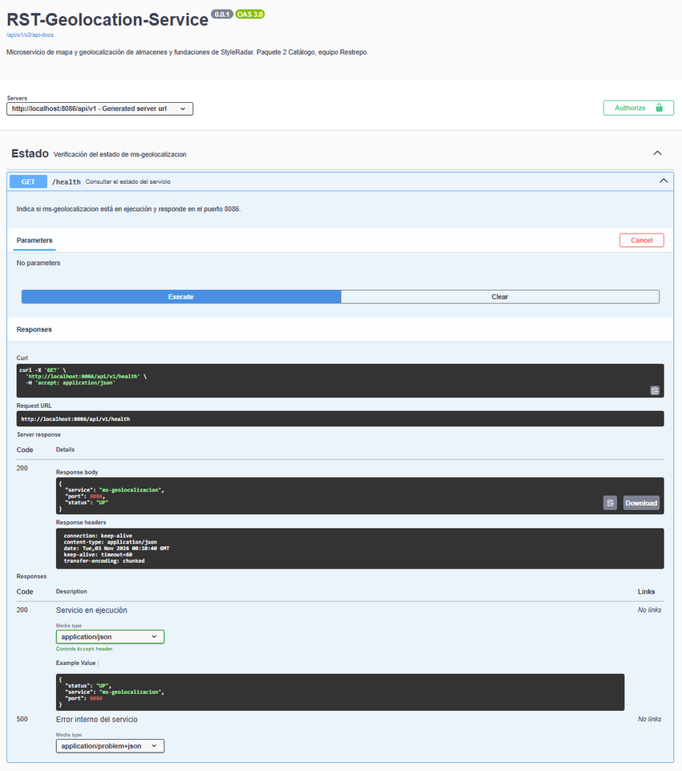

##  4. ENDPOINTS Y ENLACE A SWAGGER

### Categorías de almacén (SR-RF-18)

Se crean en todos los ambientes con la migración `V4__categorias_unificadas.sql`. `GET /api/v1/almacenes` recibe la ubicación del usuario (`lat`, `lng`) y un `radioKm` opcional (por defecto 5, máximo 20), y devuelve los almacenes dentro del radio del más cercano al más lejano. El filtro `categoriaId` usa estos IDs, y cada almacén devuelve su `categoriaId`, `categoria` y `distanciaKm`.

| Categoría | categoriaId |
| :--- | :--- |
| Casual | `44444444-4444-4444-4444-444444444444` |
| Formal | `11111111-1111-1111-1111-111111111111` |
| Deportivo | `55555555-5555-5555-5555-555555555555` |
| Urbano | `22222222-2222-2222-2222-222222222222` |
| Vintage | `33333333-3333-3333-3333-333333333333` |
| Accesorios | `66666666-6666-6666-6666-666666666666` |
| Calzado | `77777777-7777-7777-7777-777777777777` |

### Matriz Oficial de Enlaces por Entorno (PROD, QA, LOCAL)

| Entorno | Estado | Propósito | URL Base del Servicio | Swagger OpenAPI UI | Health Check |
| :--- | :---: | :--- | :--- | :--- | :--- |
| **Producción (PROD)** | Desplegado | Despliegue productivo de StyleRadar | `https://rst-geolocation-service-prod.redwave-74d6e30f.northcentralus.azurecontainerapps.io/api/v1` | [Swagger UI PROD](https://rst-geolocation-service-prod.redwave-74d6e30f.northcentralus.azurecontainerapps.io/api/v1/swagger-ui/index.html) | [`/health`](https://rst-geolocation-service-prod.redwave-74d6e30f.northcentralus.azurecontainerapps.io/api/v1/health) |
| **Calidad / Pruebas (QA)** | Desplegado | Pruebas integradas del Sprint | `https://rst-geolocation-service-qa.redwave-74d6e30f.northcentralus.azurecontainerapps.io/api/v1` | [Swagger UI QA](https://rst-geolocation-service-qa.redwave-74d6e30f.northcentralus.azurecontainerapps.io/api/v1/swagger-ui/index.html) | [`/health`](https://rst-geolocation-service-qa.redwave-74d6e30f.northcentralus.azurecontainerapps.io/api/v1/health) |
| **Desarrollo Local (DEV)** | Local | Entorno de desarrollo local | `http://localhost:8240/api/v1` | [Swagger UI Local](http://localhost:8240/api/v1/swagger-ui.html) | [`/health`](http://localhost:8240/api/v1/health) |

* **Nota:** en QA y PROD el servicio se apaga por inactividad (Azure Container Apps), así que la primera petición puede tardar cerca de un minuto.
### Formato de los errores

Todos los errores responden `application/problem+json` (RFC 7807) con `type`, `title`, `status`, `detail`, `instance`, `code` y `timestamp` (ISO-8601); en los 400 de validación se agrega `errors` con el mensaje de cada campo.

| HTTP | `code` | Cuándo |
| :---: | :--- | :--- |
| 400 | `PARAMETRO_INVALIDO` | Falta `lat` o `lng`, no son números, están fuera de rango en `/almacenes`, `radioKm` no es válido o `categoriaId` no es un UUID |
| 404 | `ALMACEN_NO_ENCONTRADO` | El almacén no existe |
| 404 | `RUTA_NO_ENCONTRADA` | La ruta no existe |
| 422 | `COORDENADA_FUERA_DE_RANGO` | La latitud no está entre -90 y 90 o la longitud entre -180 y 180 |
| 422 | `RADIO_INVALIDO` | `radioKm` es negativo en fundaciones cercanas |
| 500 | `ERROR_INTERNO` | Error inesperado |

* **Especificación OpenAPI:** `http://localhost:8240/api/v1/v3/api-docs`

  <table width="100%" style="margin: 18px 0; border: 2px dashed #5600EF; border-radius: 8px; background-color: #FBFBFE;">
    <tr>
      <td align="center" style="padding: 22px;">
        

           
          <strong>DOCUMENTACIÓN SWAGGER OPENAPI UI ACTIVA</strong>
        

        

 
        

      </td>
    </tr>
  </table>

### Tabla de Endpoints Expuestos

| Método | Endpoint | Descripción | Rol Requerido | Códigos HTTP |
| :---: | :--- | :--- | :--- | :---: |
| `GET` | `/api/v1/almacenes` | Listar los almacenes aliados dentro de `radioKm` (por defecto 5, máximo 20) de la ubicación del usuario (`lat`, `lng`), del más cercano al más lejano y con `distanciaKm`; con `categoriaId` opcional filtra por categoría (SR-RF-17 y 18) | Público | `200`, `400` |
| `GET` | `/api/v1/almacenes/{id}/distancia` | Calcular en kilómetros la distancia entre la ubicación del usuario (`lat`, `lng`) y el almacén (SR-RF-21) | Público | `200`, `400`, `404`, `422` |
| `GET` | `/api/v1/fundaciones/cercanas` | Consultar las fundaciones aliadas a menos de `radioKm` (por defecto 5) de la ubicación `lat`, `lng` (SR-RF-43) | Público | `200`, `400`, `422` |
| `GET` | `/api/v1/health` | Estado del servicio | Público | `200` |

---

<a href="../README.md">⬅ Volver al índice</a>

