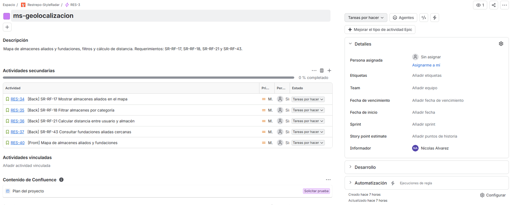

##  12. ENLACE A LA ÉPICA EN JIRA

### Enlaces de Gestión, Repositorios y Evidencias

* **Épica del Microservicio:** [RES-3 · ms-geolocalizacion](https://mail-team-nyjtgqcj.atlassian.net/browse/RES-3)
* **Tablero del Equipo:** [Restrepo-StyleRadar (RES)](https://mail-team-nyjtgqcj.atlassian.net/jira/software/projects/RES/boards/76)

  <table width="100%" style="margin: 18px 0; border: 2px dashed #5600EF; border-radius: 8px; background-color: #FBFBFE;">
    <tr>
      <td align="center" style="padding: 22px;">
        

           
          <strong>TABLERO SCRUM Y SEGUIMIENTO DE LA ÉPICA EN JIRA</strong>
        

        

 
        

      </td>
    </tr>
  </table>

### Requerimientos Funcionales Asignados

| Código RF | Nombre del Requerimiento | Historia en Jira |
| :---: | :--- | :---: |
| `SR-RF-17` | Mostrar almacenes aliados en el mapa | `RES-34` |
| `SR-RF-18` | Filtrar almacenes por categoría | `RES-35` |
| `SR-RF-21` | Calcular distancia entre usuario y almacén | `RES-36` |
| `SR-RF-43` | Consultar fundaciones aliadas cercanas | `RES-37` |

---

<a href="../README.md">⬅ Volver al índice</a>

